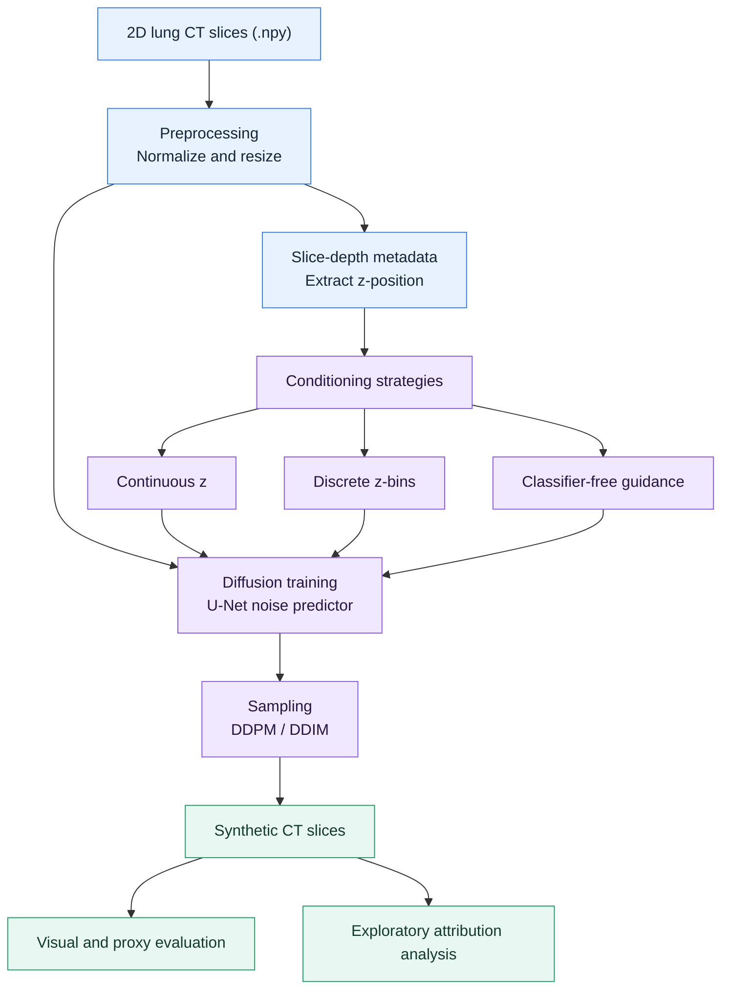

<div align="center">

<h1>Conditional Diffusion for Lung CT Synthesis</h1>

<p><strong>Anatomy-conditioned image generation &amp; exploratory imaging-biomarker analysis</strong></p>

<p>
  
  
  
  
</p>

<p><em>A research project exploring how diffusion models can synthesize 2D lung CT slices under anatomical depth conditioning, and how generated images behave under qualitative and exploratory attribution analysis.</em></p>

<p>
  <a href="#project-overview">Project overview</a> ·
  <a href="#methodology">Methodology</a> ·
  <a href="#evaluation--observations">Evaluation</a> ·
  <a href="#repository-structure">Repository</a> ·
  <a href="#getting-started">Getting started</a>
</p>

</div>

> [!IMPORTANT]
> **Research prototype — not a medical device.** The generated CT images and exploratory attribution findings are **not clinically validated** and must not be used for diagnosis, treatment decisions, or claims of biomarker discovery in patients.

---

## Project overview

Medical image generation can be difficult because plausible texture alone does not guarantee plausible anatomy. This project investigates **diffusion-based synthesis of 2D lung CT slices**, focusing on whether the model can represent changes in appearance across the position of a slice within a CT volume.

The work compares multiple generation and conditioning strategies and investigates visual fidelity and exploratory explanations on real and synthetic images.

| Research dimension | Approach |
| :--- | :--- |
| **Imaging modality** | 2D lung CT slices |
| **Input format** | NumPy arrays (`.npy`) |
| **Image preparation** | Normalization to `[0, 1]`; experiments at `128 × 128` or `256 × 256` |
| **Core architecture** | U-Net-based diffusion models |
| **Conditioning** | Normalized slice depth, discrete depth bins, classifier-free guidance |
| **Sampling** | DDPM and DDIM variants |
| **Assessment** | Visual comparisons, checkpoint consistency, exploratory attributions |

### Research questions

1. How does conditioning on **slice depth (z-position)** affect the appearance of synthetic CT slices?
2. How do unconditional, continuous-depth, discrete-bin, and guidance-based strategies compare qualitatively?
3. Which anatomical regions are reproduced more consistently, and where do generation artifacts remain?
4. Do exploratory attribution methods emphasize informative lung regions or predominantly high-contrast structures?

## Methodology



### 1. Data preparation

- Load 2D lung CT slices provided as `.npy` arrays.
- Normalize image intensities to `[0, 1]` and resize according to the experiment configuration.
- Extract slice-depth information from filenames.
- Represent anatomical depth either as a normalized continuous value or as a discrete **z-bin**.

**Dataset availability:** The CT dataset is **not distributed in this repository**. Dataset acquisition, authorization, and any associated usage conditions must be handled separately.

### 2. Diffusion models and conditioning

| Strategy | Conditioning information | Role in the experiments |
| :--- | :--- | :--- |
| **Unconditional diffusion** | None | Baseline image generation |
| **Continuous z-conditioning** | Normalized slice position | Depth-aware synthesis |
| **Discrete z-bin conditioning** | Anatomical depth group | Category-conditioned synthesis |
| **Classifier-free guidance (CFG)** | Conditional and unconditional prediction paths | Explore conditioning strength during sampling |

Implementations described in the project include **custom DDPM code** and experiments using the Hugging Face **`diffusers`** library. The research considers **linear** and **squared-cosine** noise schedules, as well as **DDPM** and **DDIM** sampling.

### 3. Training and sampling

The reported experimental setup uses:

- **Mean squared error (MSE)** for noise-prediction training.
- **Exponential moving average (EMA)** of model weights.
- **Fixed-noise DDIM samples** for more consistent visual comparisons across checkpoints.
- Multiple training configurations to assess stability and conditioning behavior.

## Evaluation & observations

The repository documents **qualitative observations and proxy evaluation**, rather than clinically validated performance measures. No numerical benchmark is asserted here without a corresponding published result.

| Area | Reported observation | Interpretation |
| :--- | :--- | :--- |
| **Mid and upper lung slices** | Comparatively stronger synthetic results | Some anatomical regions appear easier to reproduce |
| **Lower lung slices** | Lower visual quality | Generation varies with slice depth |
| **Generation artifacts** | Residual noise and anatomical distortions | Synthetic realism remains imperfect |
| **Checkpoint evaluation** | Fixed-noise comparisons and internal consistency checks | Useful for tracking experiments, not proof of clinical validity |

### Exploratory imaging-biomarker analysis

The project also examines attribution patterns in real and synthetic CT images. Reported observations include:

- Emphasis on **high-contrast structures**, including edges, bones, and boundaries.
- Limited localization within the **lung parenchyma**.
- Motivation for future work with stronger anatomical constraints and segmentation.

These findings are **exploratory**. They do not establish a validated imaging biomarker, disease classifier, or diagnostic capability.

## Repository structure

The published repository is organized around an experiment directory:

```text
Generative-AI-for-New-Diseases-Imaging-Biomarker-Discovery/
├── covid-gen-final/    # Research code and experiment materials
└── README.md           # Project documentation
```

The exact runnable entry points and experiment-specific dependencies should be checked inside `covid-gen-final/`. They are not assumed to be identical across the different modeling approaches.

## Getting started

### 1. Clone the repository

```bash
git clone https://github.com/Bereke3/Generative-AI-for-New-Diseases-Imaging-Biomarker-Discovery.git
cd Generative-AI-for-New-Diseases-Imaging-Biomarker-Discovery
```

### 2. Inspect the experiment files

```bash
ls -la covid-gen-final
find covid-gen-final -maxdepth 2 -type f | sort
```

### 3. Prepare your research environment

Review the experiment files for the required Python packages, input data paths, configuration options, and model checkpoints before running any training or generation workflow. **A verified one-command installation or reproduction procedure has not yet been documented** in the public repository.

Because the dataset is not included, a fresh clone alone is not sufficient to reproduce the training runs.

## Limitations & responsible use

- **Not clinically validated:** Visual quality and exploratory attribution analysis do not demonstrate diagnostic accuracy.
- **2D scope:** Results concern individual CT slices, not validated 3D volumetric consistency.
- **Depth-dependent quality:** Anatomical fidelity varies across slice locations.
- **Unavailable dataset:** Full reproduction requires separately obtaining the research data and checking its usage permissions.
- **Evaluation scope:** Proxy metrics and qualitative review are not substitutes for independent clinical or expert evaluation.

## Future research directions

- Incorporate anatomical segmentation or structure-aware conditioning.
- Evaluate consistency across adjacent slices and, eventually, 3D volumes.
- Add clearly defined quantitative benchmarks and expert-based image review.
- Document exact training commands, dependency versions, seeds, and experiment configurations.
- Assess whether attribution patterns remain stable under stronger validation protocols.

---

<div align="center">
  <p><strong>Conditional Diffusion for Lung CT Synthesis</strong><br />
  <em>Academic research in generative medical imaging — research use only</em></p>
</div>
